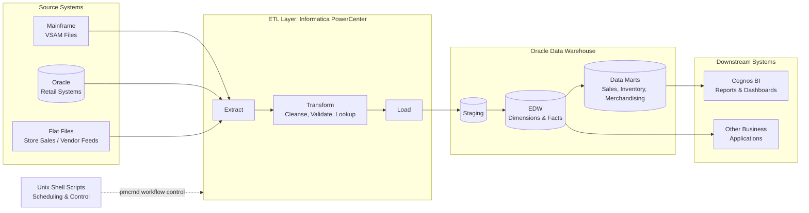
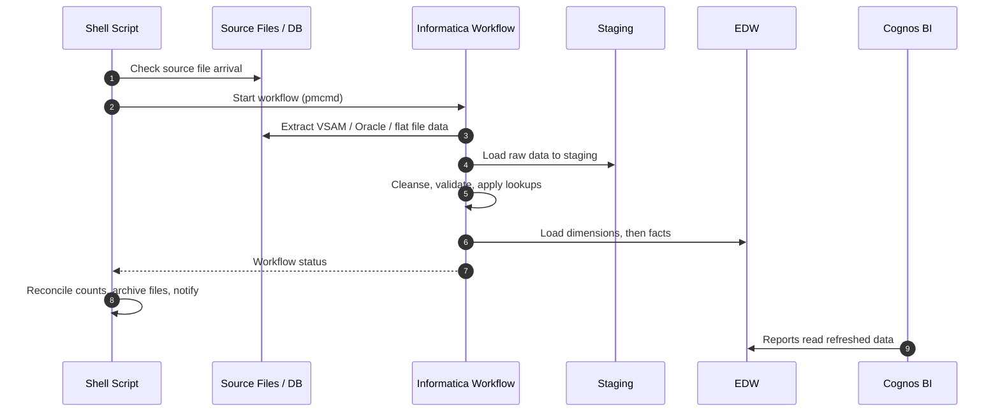

# 🏪 Enterprise Data Warehouse — 7-Eleven (US Retail)

## 🎯 Project Overview

| Item | Description |
|---|---|
| **Client** | 7-Eleven, Inc. — US Retail Company |
| **Duration** | 2010 – 2012 |
| **Role** | ETL Developer — Enterprise Data Warehouse |
| **Location** | Offshore (India) with a 1-year onsite assignment at the US client site (implementation and support) |
| **Project Type** | Enterprise Data Warehouse (EDW) design and implementation |
| **Technologies** | Informatica PowerCenter, Oracle, VSAM files, Unix shell scripts, Cognos BI |

Proposed, designed and led the implementation of an **Enterprise Data Warehouse** for 7-Eleven's US retail business. The EDW extracts data from multiple source systems, including mainframe VSAM files and Oracle databases, then transforms it and loads it into a central Oracle data warehouse. The warehouse is the single source of data for downstream systems: **Cognos BI reports** and other business applications.

ETL was built with **Informatica PowerCenter** and orchestrated with **Unix shell scripts**, with Oracle as the warehouse back end.

---

## 💼 Business Objectives

- **Single source of truth:** combine store sales, merchandising, inventory, vendor and finance data from separate source systems into one trusted warehouse.
- **Faster, consistent reporting:** give business users timely, consistent Cognos reports on store and product performance instead of manual extracts and spreadsheets.
- **Unlock legacy data:** make mainframe VSAM data available for analysis alongside Oracle-based systems.
- **Reliable data feeds:** supply clean, validated data to downstream reporting and applications on a fixed daily schedule.
- **Data quality:** standardize, validate and reconcile data during loading, so reports can be trusted.
- **Scalable foundation:** create a reusable ETL framework that new sources and subject areas can be added to easily.

---

## 🏗️ Architecture

### Components

| Component | Responsibility |
|---|---|
| **Source systems** | Mainframe VSAM files, Oracle databases and flat files covering store sales, merchandising, inventory, vendors and finance |
| **Informatica PowerCenter** | Mappings, sessions and workflows to extract, cleanse, transform and load data |
| **Staging area** | Raw copy of source data for validation, auditing and reprocessing |
| **Enterprise Data Warehouse** | Integrated, historical data in a dimensional (star schema) model on Oracle — e.g. store, product, vendor and date dimensions with sales and inventory facts |
| **Data marts** | Subject-area tables and views tuned for reporting |
| **Unix shell scripts** | Start workflows (`pmcmd`), check source file arrival, archive files, handle errors and send notifications |
| **Cognos BI** | Business reports and dashboards built on the warehouse |

### ETL Load Flow

### Design Highlights

| Area | Approach |
|---|---|
| **Data model** | Dimensional model (star schema) with conformed dimensions such as store, product, vendor and date |
| **Load strategy** | Initial full load, then daily incremental loads |
| **Change handling** | Slowly changing dimensions (Type 1 and Type 2) for history |
| **VSAM handling** | COBOL copybook-based source definitions; Normalizer transformation for repeating groups |
| **Data quality** | Validation rules, reject handling, lookups for referential integrity |
| **Reconciliation** | Source vs target row counts and control totals after each load |
| **Error handling** | Session logs, reject files, restartable workflows and email alerts |
| **Performance** | Partitioned sessions, bulk loading, indexed lookups, pushdown where suitable |

---

## 👤 My Contribution

- **Requirement study:** gathered and analysed reporting and data requirements with business users and source system owners.
- **Design:** proposed and designed the EDW solution, including the data model, source-to-target mappings and the ETL load approach.
- **Development support:** assisted in developing Informatica PowerCenter mappings, sessions and workflows and the Unix shell scripts that run them.
- **Testing:** planned and carried out unit, integration and data validation testing of ETL loads.
- **Coordination:** coordinated activities between business, source system, development and reporting (Cognos) teams.
- **Onsite implementation & support (US):** spent 1 year onsite at the client site in the US, leading the EDW implementation and go-live, and providing production support for daily loads, monitoring, fixes and enhancements after go-live.
- **Issue resolution:** investigated and resolved data loading issues such as data mismatches, rejected records and load failures.
