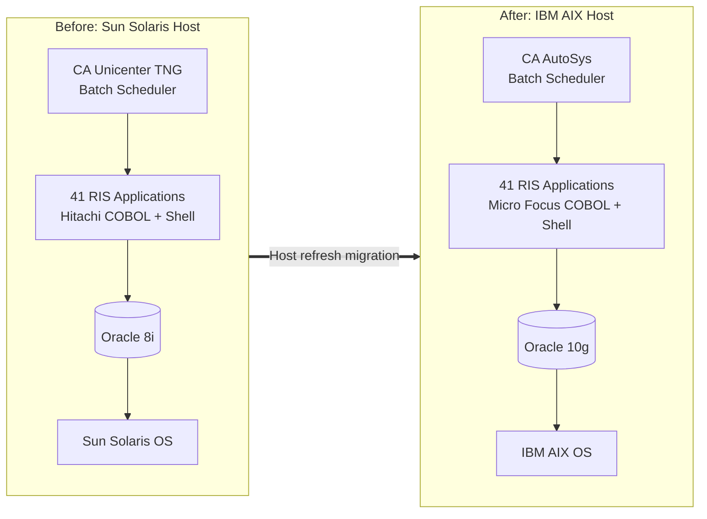
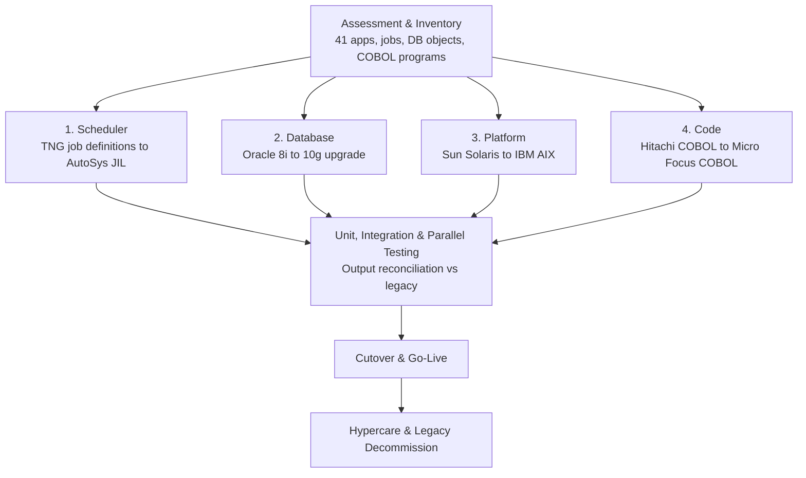

# 🔄 RIS Host Refresh — Oracle, Scheduler & Unix Server Migration

## 🎯 Project Overview

| Item | Description |
|---|---|
| **Client** | 7-Eleven, Inc. (US) — Retail Information Systems (RIS) |
| **Duration** | 2008 – 2010 |
| **Role** | Oracle Developer |
| **Location** | Offshore (India) with two 3-month onsite assignments in the USA on a business visa — Plano, Texas (system study) and the US client site (implementation) |
| **Project Type** | Platform modernization / host refresh |
| **Scope** | 41 RIS applications, Oracle databases, batch scheduling and COBOL code base |
| **Technologies** | Oracle 8i → Oracle 10g, CA Unicenter TNG → CA AutoSys, Sun Solaris → IBM AIX, Hitachi COBOL → Micro Focus COBOL, Unix shell scripting, PL/SQL, SQL*Plus, SQL*Loader |

The RIS host refresh project moved 7-Eleven's Retail Information Systems off ageing, end-of-support infrastructure onto a modern, supported platform. It covered four tracks delivered together:

| # | Workstream | From | To |
|---|---|---|---|
| 1 | **Scheduler conversion** | CA Unicenter TNG | CA AutoSys |
| 2 | **Database upgrade** | Oracle 8i | Oracle 10g |
| 3 | **Application migration** | Sun Solaris | IBM AIX (41 applications) |
| 4 | **Code conversion** | Hitachi COBOL | Micro Focus COBOL |

All 41 applications were migrated with the same business functionality, data and batch outcomes, verified by parallel runs and reconciliation against the legacy system before cutover.

---

## 💼 Business Objectives

- **Remove end-of-support risk:** retire Oracle 8i, the ageing Sun Solaris servers and Unicenter TNG, which were no longer supported by their vendors.
- **Improve performance and capacity:** use IBM AIX servers and Oracle 10g features (cost-based optimizer improvements, automatic memory and statistics management) to shorten batch windows.
- **Standardize batch scheduling:** move to CA AutoSys for centralized job control, dependencies, alerting and monitoring across all RIS jobs.
- **Keep the code base supportable:** convert Hitachi COBOL to Micro Focus COBOL, which is widely supported and runs natively on AIX.
- **Zero business impact:** keep store reporting, merchandising, inventory and sales batch processes running with identical results.
- **Reduce operating cost:** consolidate onto standard platforms and tools with lower licensing and support effort.

---

## 🏗️ Architecture

### Before and After

### Migration Workstreams

### Workstream Details

| Workstream | Key Activities |
|---|---|
| **1. Scheduler (TNG → AutoSys)** | Extracted TNG job definitions, calendars and dependencies; rebuilt them as AutoSys JIL (boxes, command jobs, file watchers); kept run times, conditions and alerting; validated job flows end to end |
| **2. Database (Oracle 8i → 10g)** | Moved schemas and data to 10g on AIX (export/import); reviewed and tuned SQL and PL/SQL for the 10g optimizer; replaced deprecated features; rebuilt indexes and gathered statistics; validated row counts and checksums |
| **3. Platform (Solaris → AIX)** | Ported Solaris shell scripts, file paths, environment settings and utilities to AIX; updated Oracle client connectivity; tested file transfers and interfaces to upstream and downstream systems |
| **4. Code (Hitachi → Micro Focus COBOL)** | Converted vendor-specific syntax, compiler directives and file handling; recompiled and linked on AIX; checked numeric, date and sort behaviour; regression-tested outputs against legacy |

### Testing & Cutover Approach

| Stage | Approach |
|---|---|
| **Unit testing** | Each converted program, script and job tested in isolation |
| **Integration testing** | Full batch cycles run under AutoSys against Oracle 10g |
| **Parallel run** | Legacy and new hosts run side by side; reports, extracts and table data reconciled |
| **Performance testing** | Batch window timings compared with the legacy host |
| **Cutover** | Planned, phased go-live with rollback plan and final data sync |
| **Hypercare** | Post-go-live monitoring and support before decommissioning the legacy host |

### My Contribution

- **Onsite knowledge transition (US):** spent 3 months onsite in Plano, Texas, on a business visa to study the current systems first-hand with 7-Eleven business and IT teams, and passed that knowledge to the offshore team.
- **System study & requirements analysis:** studied the existing RIS applications, Oracle 8i databases, TNG batch schedules and COBOL programs; analysed the migration requirements and mapped what had to change for Oracle 10g, AutoSys, AIX and Micro Focus COBOL.
- **Migration tracking:** tracked migration activities across the four workstreams and all 41 applications, monitoring the status of conversion, testing and cutover tasks.
- **Onsite implementation (US):** returned to the US for a second 3-month onsite assignment to support implementation, working with 7-Eleven teams on deployment, cutover and go-live of the migrated applications on the new platform.
- **Issue resolution:** investigated and resolved migration issues across database, batch job, platform and COBOL conversion areas, so applications ran on the new environment with the same results as the legacy system.
