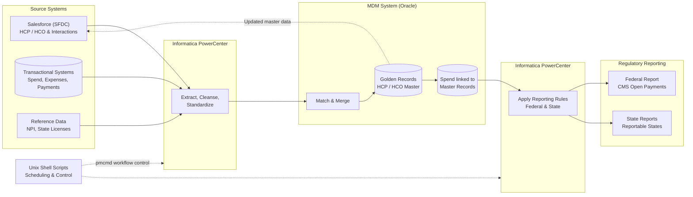
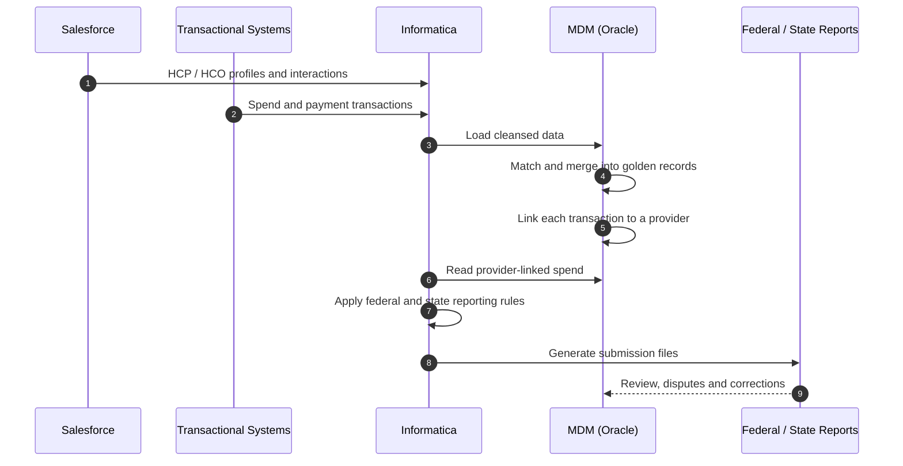

# 💊 MDM for Federal & State Transparency Reporting — AbbVie (US Life Sciences)

## 🎯 Project Overview

| Item | Description |
|---|---|
| **Client** | AbbVie — US Life Sciences Company |
| **Duration** | 2016 – 2017 |
| **Role** | System Lead — MDM Systems |
| **Location** | Offshore (India) |
| **Project Type** | Master Data Management (MDM) enhancement for regulatory reporting |
| **Technologies** | Informatica PowerCenter, Salesforce (SFDC), Oracle, Unix shell scripts |

Enhanced and expanded the **Master Data Management (MDM)** system by combining **transactional spend data** with **healthcare professional (HCP) and organization (HCO) information from Salesforce**. The MDM system provides a single, trusted record of each healthcare provider and links every payment or transfer of value to the correct provider. This data drives the company's **federal transparency reporting** (Physician Payments Sunshine Act / CMS Open Payments) and **reporting to specific states** with their own disclosure laws.

Integration was built with **Informatica PowerCenter** (including Salesforce connectivity), orchestrated with **Unix shell scripts**, with **Oracle** as the back end.

---

## 💼 Business Objectives

- **Regulatory compliance:** report payments and transfers of value to healthcare providers accurately and on time to the federal government and to states with their own reporting laws.
- **Single provider identity:** keep one golden record per HCP and HCO, matched across Salesforce and transactional systems using identifiers such as NPI and state license.
- **Complete spend picture:** combine transactional spend data with Salesforce interaction data, so no reportable payment is missed or double counted.
- **Avoid penalties and reputational risk:** reduce reporting errors, disputes and resubmissions that can lead to fines.
- **Audit readiness:** keep full traceability from each reported amount back to its source transaction.
- **Flexible for new rules:** make it easy to add new reportable states or changes to reporting rules.

---

## 🏗️ Architecture

### Components

| Component | Responsibility |
|---|---|
| **Salesforce (SFDC)** | Source of HCP and HCO profiles and field interactions such as meals, speaker programs and samples |
| **Transactional systems** | Source of spend data: payments, expenses, grants, consulting fees |
| **Reference data** | Provider identifiers such as NPI and state license numbers used for matching |
| **Informatica PowerCenter** | Extracts from Salesforce and other sources, cleanses data, loads the MDM system and builds report files |
| **MDM system (Oracle)** | Matches and merges provider records into golden records and links spend to them |
| **Reporting layer** | Applies federal and state rules and produces submission files |
| **Unix shell scripts** | Start workflows (`pmcmd`), file checks, archiving, error handling and notifications |

### Reporting Flow

### Design Highlights

| Area | Approach |
|---|---|
| **Matching** | Deterministic and rule-based matching on NPI, license, name and address |
| **Data quality** | Standardized names and addresses, validation of identifiers, exception queues for unmatched records |
| **Reporting rules** | Configurable rules per federal and state requirement (thresholds, categories, exclusions) |
| **Traceability** | Every reported amount linked back to its source transaction and provider record |
| **Load strategy** | Scheduled incremental loads from Salesforce and transactional systems |
| **Security** | Restricted access to provider and payment data |
| **Deployment** | Reviewed deployment packages promoted from development to test and production |

---

## 👤 My Contribution

- **Project planning:** planned scope, tasks, effort and timelines for the MDM enhancements.
- **Requirement study:** analysed federal and state reporting requirements and source data with compliance, business and Salesforce teams.
- **Design specifications:** prepared design specifications for the data flows, matching rules, MDM changes and report outputs.
- **Lead design & development:** led the design and guided the team in building Informatica mappings, workflows, Salesforce integration and shell scripts.
- **Deployment review:** reviewed deployment packages (Informatica objects, database scripts and shell scripts) for quality and completeness.
- **Higher-environment deployment:** managed deployments into test and production environments.
