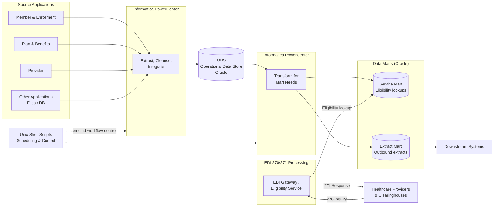
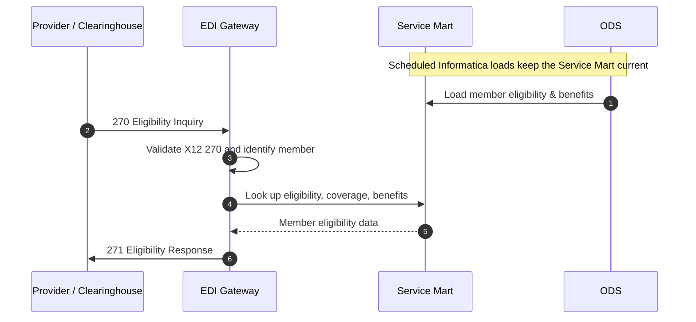

# 🏥 ODS & Data Marts for EDI 270/271 Eligibility Transactions — Cigna (US Healthcare)

## 🎯 Project Overview

| Item | Description |
|---|---|
| **Client** | Cigna — US Healthcare Company |
| **Duration** | 2013 – 2016 |
| **Role** | System Lead — ODS and Data Marts (Service / Extract Marts) |
| **Location** | Offshore (India) |
| **Project Type** | Operational Data Store (ODS) enhancement and Data Mart development |
| **Technologies** | Informatica PowerCenter, Oracle, Unix shell scripts |

Enhanced and expanded the **Operational Data Store (ODS)**, the intermediate data layer that collects data from multiple applications and source systems and serves it according to downstream business needs. Data from the ODS is loaded into two purpose-built data marts, the **Service Mart** and the **Extract Mart**, which supply member eligibility and benefit data for **HIPAA EDI 270/271 transactions** (Health Care Eligibility Benefit Inquiry and Response).

ETL was built with **Informatica PowerCenter**, orchestrated with **Unix shell scripts**, with **Oracle** as the back end.

---

## 💼 Business Objectives

- **Accurate eligibility responses:** give providers correct, up-to-date member eligibility and benefit information in EDI 271 responses to their 270 inquiries.
- **Central operational data layer:** extend the ODS as the single integration point for member, enrollment, plan, benefit and provider data from many source applications.
- **Fit-for-purpose data marts:** shape ODS data into a Service Mart for fast eligibility lookups and an Extract Mart for scheduled outbound extracts.
- **Faster turnaround:** cut response times for eligibility checks, helping providers verify coverage before delivering care.
- **HIPAA compliance:** support the standard X12 270/271 transaction set and keep sensitive member data secure.
- **Scalability:** make it easy to add new sources and downstream consumers without changing the existing applications.

---

## 🏗️ Architecture

### Components

| Component | Responsibility |
|---|---|
| **Source applications** | Member, enrollment, plan, benefit, provider and other operational systems |
| **ODS** | Intermediate, integrated data repository holding current operational data from all sources |
| **Service Mart** | Eligibility and benefit data structured for fast lookups when building 271 responses |
| **Extract Mart** | Data shaped for scheduled extracts to downstream systems and trading partners |
| **Informatica PowerCenter** | Mappings, sessions and workflows for source-to-ODS and ODS-to-mart loads |
| **Unix shell scripts** | Start workflows (`pmcmd`), file checks, archiving, error handling and notifications |
| **EDI gateway / eligibility service** | Receives 270 inquiries, reads the Service Mart and returns 271 responses |

### EDI 270/271 Flow

### Design Highlights

| Area | Approach |
|---|---|
| **Layering** | Sources → ODS → Service / Extract Marts, so each layer has one job |
| **Load strategy** | Incremental (delta) loads into the ODS and marts on a schedule |
| **Mart design** | Service Mart denormalized and indexed for fast lookups; Extract Mart organized by consumer and file layout |
| **Data quality** | Validation rules, reject handling and lookups for member and plan integrity |
| **Reconciliation** | Row counts and control totals between source, ODS and marts |
| **Performance** | Partitioned sessions, bulk loading, indexed lookups and SQL tuning, verified with performance testing |
| **Security** | Restricted access to member data (PHI) in line with HIPAA |
| **Deployment** | Versioned deployment packages reviewed before release to each environment |

---

## 👤 My Contribution

- **Project planning:** planned project scope, tasks, effort and timelines for the ODS and data mart enhancements.
- **Requirement study:** analysed business and downstream requirements for 270/271 eligibility data with business and source system teams.
- **Gap analysis:** compared current ODS and source data with the new requirements and identified the data, mapping and process gaps to close.
- **Lead design & development:** led the design of the ODS extensions and the Service and Extract Marts, and guided the team in building Informatica mappings, workflows and shell scripts.
- **Performance testing:** planned and ran performance tests, and tuned ETL loads and SQL to meet load windows and response-time targets.
- **Deployment review:** reviewed deployment packages (Informatica objects, database scripts and shell scripts) before release to each environment.
