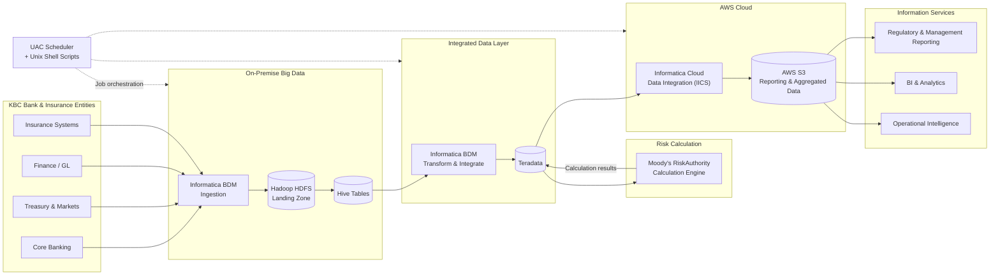
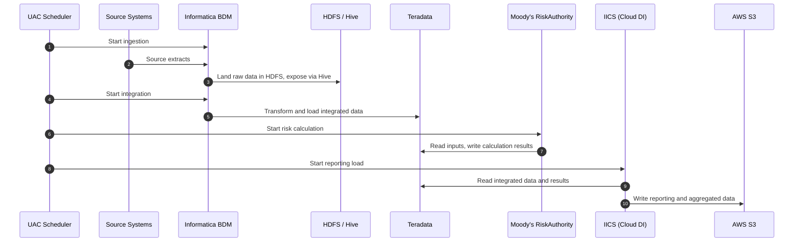

# 🌈 Rainbow — Risk, Finance & Treasury Information Platform — KBC Bank (Belgium)

## 🎯 Project Overview

| Item | Description |
|---|---|
| **Client** | KBC Bank — Belgium |
| **Duration** | 2017 – 2019 |
| **Role** | Solution Architect — Rainbow (CRSP1) with Risk Management Systems |
| **Location** | Offshore (India) with a 1-year onsite assignment in Belgium (client-facing and customer support) |
| **Project Type** | Enterprise risk, finance and treasury data platform (hybrid big data and cloud) |
| **Technologies** | Informatica BDM, Informatica Intelligent Cloud Services (IICS – Data Integration), AWS S3, Hadoop (HDFS), Hive, Teradata, Moody's RiskAuthority, UAC scheduler, Unix shell scripts |

**Rainbow** is KBC Group's standard platform for all information services in the **Risk, Finance and Treasury** domains. It provides reporting, calculation, analytics, business intelligence and operational intelligence services. Rainbow is built as one reusable solution that can be used by KBC Group and by any KBC bank or insurance entity.

The platform combines on-premise big data and cloud services:

| Layer | Technology | Purpose |
|---|---|---|
| **Landing zone** | Hadoop / HDFS | Raw data from source systems across KBC entities |
| **Data access** | Hive tables on HDFS | Structured, queryable view of landed data |
| **Integrated data layer** | Teradata | Integrated, conformed risk, finance and treasury data |
| **Calculation engine** | Moody's RiskAuthority | Regulatory risk and capital calculations |
| **Reporting & aggregated data** | Informatica Cloud Data Integration (IICS) + AWS S3 | Aggregated and reporting data in the AWS cloud |

---

## 💼 Business Objectives

- **One standard platform:** give every KBC bank and insurance entity the same solution for risk, finance and treasury information, instead of separate local systems.
- **Regulatory compliance:** produce accurate, timely regulatory risk and capital figures using an industry-standard calculation engine.
- **Single, trusted data layer:** integrate data from many entities and source systems into one consistent layer for reporting and analytics.
- **Scalable data handling:** use Hadoop to land and process large data volumes cost-effectively.
- **Cloud-ready reporting:** deliver aggregated and reporting data through AWS for flexible, scalable consumption.
- **Faster insight:** support reporting, analytics, BI and operational intelligence from the same platform.

---

## 🏗️ Architecture

### Components

| Component | Responsibility |
|---|---|
| **Source systems** | Banking, treasury, finance and insurance systems across KBC entities |
| **Informatica BDM** | Big data ingestion into HDFS and transformation from Hive into Teradata |
| **Hadoop HDFS** | Landing zone that keeps raw source data at scale |
| **Hive tables** | Schema on top of HDFS so landed data can be queried and processed |
| **Teradata** | Integrated data layer with conformed risk, finance and treasury data |
| **Moody's RiskAuthority** | Calculation engine for regulatory risk and capital figures |
| **Informatica IICS (DI)** | Cloud data integration that builds aggregated and reporting data sets |
| **AWS S3** | Cloud storage for reporting and aggregated data used by downstream services |
| **UAC scheduler** | Orchestrates jobs and dependencies across all layers |
| **Unix shell scripts** | File handling, job control, error handling and notifications |

### End-to-End Data Flow

### Design Highlights

| Area | Approach |
|---|---|
| **Multi-entity design** | One standard data model and pipeline reusable by any KBC bank or insurance entity |
| **Layering** | Landing (HDFS) → access (Hive) → integration (Teradata) → calculation (Moody's) → reporting (S3) |
| **Hybrid architecture** | Heavy processing on-premise; reporting and aggregated data in the AWS cloud |
| **Data quality** | Validation and reconciliation between source, landing zone, Teradata and S3 |
| **Traceability** | Lineage from reported figures back to source data, as regulators expect |
| **Orchestration** | UAC manages end-to-end dependencies, restarts and alerts |
| **Security** | Controlled access to sensitive bank data on-premise and in AWS |
| **Deployment** | Reviewed packages promoted through test, acceptance and production environments |

---

## 👤 My Contribution

- **Requirement study:** analysed risk, finance and treasury information needs and source data with KBC business and IT teams.
- **Solution architecture:** shaped the end-to-end design across Hadoop, Hive, Teradata, Moody's RiskAuthority, IICS and AWS S3.
- **Design specifications:** prepared design specifications for data ingestion, integration, calculation interfaces and reporting outputs.
- **Lead design & development:** led the design and guided the team in building Informatica BDM and IICS mappings, UAC job flows and shell scripts.
- **Onsite client-facing role (Belgium):** spent 1 year onsite at KBC in Belgium as the client-facing architect, working directly with business and IT stakeholders on requirements, design reviews and delivery, and providing customer support for the Rainbow platform.
- **Higher-environment deployment:** managed deployments into test, acceptance and production environments.
